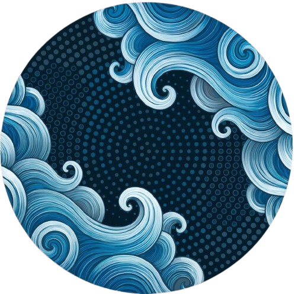

# MuaraAI

> Where local craft flows global.

MuaraAI adalah komunitas mahasiswa dari seluruh kampus di Indonesia yang lahir dari mahasiswa UBSI Pontianak. Komunitas ini terbuka untuk mahasiswa angkatan 2026 dan seterusnya, dengan ruang untuk belajar, membangun project, menunjukkan Proof of Work, dan berkontribusi bersama.

Website utama: https://muaraai.com/
AI Playground: https://ai.muaraai.com/



## Produk dan project

### Muara Arus 1

Muara Arus 1 adalah AI lokal akademik dan coding buatan MuaraAI.

- Model ID: `muara-arus-1`
- Ukuran: 1.5B parameter
- Runtime: ditujukan berjalan 100% offline
- Fokus saat ini: FTI UBSI, program SI, SIA, dan IF
- Playground: https://ai.muaraai.com/
- GitHub: https://github.com/MuaraAI/muara-arus-1
- Hugging Face: https://huggingface.co/MuaraAI/muara-arus-1
- Ollama: https://ollama.com/MuaraAI/muara-arus-1

Model ini membantu mahasiswa memahami materi akademik yang tersedia dan mengerjakan tugas dengan konteks sumber yang jelas. Cakupan pengetahuan berkembang seiring dataset dan evaluasinya.

### UBSI API

UBSI API adalah REST API unofficial yang menyatukan enam layanan digital UBSI ke dalam antarmuka JSON. Mahasiswa memakai akun mereka sendiri untuk mengakses layanan yang tersedia.

Layanan yang tercakup:

- StudentV2 / SIAKAD
- MyBest LMS
- Elibrary
- EJournal
- Repository
- News Portal

- Website: https://ubsi-api.muaraai.com
- Repository: https://github.com/MuaraAI/UBSI-API

UBSI API dikembangkan secara independen dan tidak berafiliasi, disponsori, atau dikelola oleh UBSI.

## Komunitas

MuaraAI dimulai dari mahasiswa UBSI Pontianak dan berkembang menjadi komunitas nasional lintas kampus. Pontianak adalah founding hub dan pusat utama pertemuan offline. Node jaringan pada peta landing saat ini merujuk universitas mitra lintas wilayah seperti UNTAN, ITB, UI, UGM, ITS, USU, UNAND, UNHAS, UNMUL, UNSRAT, UNIPA, dan UNCEN; label node menunjukkan jangkauan komunitas, bukan klaim chapter aktif.

Ketentuan intake saat ini:

- Mahasiswa dari kampus mana pun di seluruh Indonesia.
- Angkatan 2026 dan seterusnya.
- Alur pendaftaran: isi form onboarding terlebih dahulu, setujui Privacy Policy, Terms of Service, dan Code of Conduct, baru login GitHub OAuth, lalu submit Proof of Work.
- Detail verifikasi, membership, iuran, dan akses tersedia setelah login.

Tim inti:

- Yuken Velino | NIM 15260767 — `@Curzyori` — Founder, Maintainer, Builder
- Muhammad Raffli Aldiansyah | NIM 15260161 — `@Seeyaa77` — Co-Founder, Maintainer, Builder
- Verzio Yamanansyah | NIM 15260225 — `@MyKineID` — Co-Founder, Maintainer, Builder

## Struktur aplikasi

```text
muaraai.com/
├── /                      # Landing page dan showcase komunitas
├── /members               # Direktori publik anggota
├── /onboarding            # Form pendaftaran + legal gate + GitHub OAuth
├── /terms                 # Ketentuan layanan
├── /privacy               # Kebijakan privasi
├── /code-of-conduct       # Norma dan etika komunitas
├── /dashboard             # Workspace member: status dan next action
├── /dashboard/learn       # Muara Learn
├── /dashboard/treasury    # Kas komunitas (QRIS Segera hadir)
└── /admin                 # Workspace maintainer
    ├── /review            # Review pendaftar
    ├── /members           # Audit membership dan lifecycle
    ├── /treasury          # Pencatatan kas
    ├── /learn             # Pengelolaan materi
    ├── /mail              # Inbox dan email komunitas
    └── /achievements      # Prestasi komunitas
```

## Teknologi

- Next.js 15 App Router
- React 19
- TypeScript strict
- Tailwind CSS
- `motion/react` untuk motion UI yang fungsional
- Supabase PostgreSQL dan Supabase Auth (GitHub OAuth)
- Resend untuk email
- Discord dan Telegram untuk notifikasi private maintainer
- Vitest dan React Testing Library
- Font lokal Inter, Space Grotesk, dan JetBrains Mono
- Inline SVG icon system, tanpa emoji sebagai ikon UI

## Keamanan

- Semua secret hanya dari environment variable server, tanpa fallback di kode.
- Fail-fast ketika `NEXT_PUBLIC_SUPABASE_URL` atau `NEXT_PUBLIC_SUPABASE_ANON_KEY` tidak diset.
- Security headers aktif: HSTS, `X-Content-Type-Options`, `X-Frame-Options`, `Referrer-Policy`, `Permissions-Policy`.
- Notifikasi Discord mematikan ambient mention (`allowed_mentions.parse = []`).
- Email outbound di-escape; error internal tidak dikirim mentah ke client.
- Dokumen planning internal (`docs/prd`, `docs/superpowers`) dan state lokal tidak ikut repository.

## Desain dan motion

Visual MuaraAI memakai Fluid Currents Light:

- Kanvas terang estuary, deep riverbed ink `#072033`, river current blue `#0369A1`.
- Logo resmi dari `public/brand/muara-logo.png`, juga dipakai sebagai favicon.
- Mura sebagai mascot pendukung pada onboarding, empty state, error, dan halaman 404.
- Peta nasional di hero memakai SVG Indonesia: rute digambar bertahap menuju Pontianak sebagai founding hub, dengan parcel bergerak dan hub pulse.
- Motion mengikuti prinsip Laku: scroll reveal, active state, route drawing, dan progressive disclosure.
- Semua motion memiliki fallback `prefers-reduced-motion` (route langsung terlihat tanpa animasi).

## Menjalankan lokal

Prasyarat:

- Node.js 20.x atau 22.x LTS
- Akun GitHub aktif untuk OAuth lokal

```bash
git clone https://github.com/MuaraAI/MuaraAI.git
cd MuaraAI
npm install
cp .env.example .env.local
npm run dev
```

Buka http://localhost:3000.

Untuk OAuth lokal, daftarkan Redirect URL berikut di Supabase (Authentication → URL Configuration):

```text
http://localhost:3000/api/auth/callback
```

Jangan memasukkan secret asli ke README, source code, test, atau commit. Isi `.env.local` hanya di mesin lokal. Lihat `.env.example` untuk daftar variabel.

## Verifikasi

```bash
npm test
npx tsc --noEmit
npm run build
```

Build terakhir memverifikasi 25 route (termasuk `robots.txt`, `sitemap.xml`, dan `icon.png`) dan 130 test yang mencakup UI, membership lifecycle, webhook Pakasir, notification safety, auth boundaries, public content, mascot, dan kontrak responsive.

## Official links

- Website: https://muaraai.com/
- AI Playground: https://ai.muaraai.com/
- GitHub: https://github.com/MuaraAI
- X: https://x.com/MuaraAI
- Instagram: https://www.instagram.com/muara.ai/
- Threads: https://www.threads.com/@muara.ai
- Hugging Face: https://huggingface.co/MuaraAI
- Ollama: https://ollama.com/MuaraAI
- Email: mailto:admin@muaraai.com

## Lisensi

Lihat [LICENSE](LICENSE) untuk ketentuan lisensi repository.

Hak cipta © 2026 MuaraAI Core Team.
