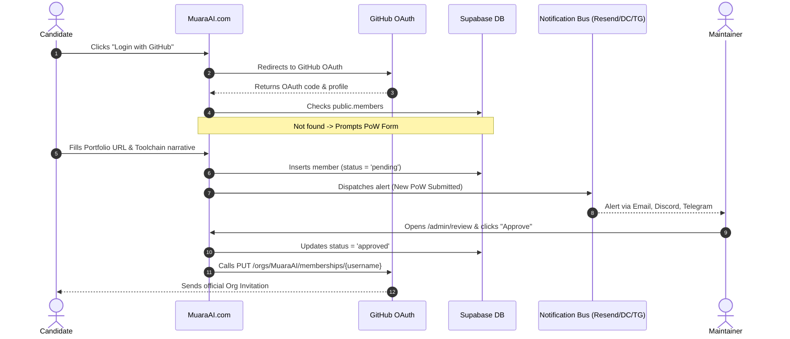
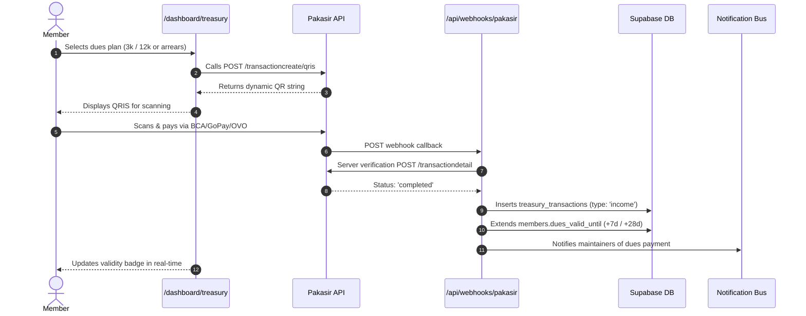

# PRD: Muara AI Web Portal (`muaraai.com`)

- **Date:** 2026-10-03
- **Status:** approved
- **Author:** Yuken Velino (Founder, @Curzyori) & Core Maintainers

---

## 1. Executive Summary

Muara AI (`muaraai.com`) is the official public portal, membership ledger, and engineering hub of the Muara AI syndicate founded by UBSI Pontianak students. The platform showcases production-grade open-source software and curated generative media, screens prospective contributors through verifiable Proof-of-Work (PoW) submissions, and automates community dues collection via dynamic QRIS. It establishes a meritocratic digital headquarters that eliminates administrative bloat and uncurated AI slop.

---

## 2. Problem Statement

Engineering and creative communities in universities often suffer from passive spectatorship ("FOMO-ers"), uncurated generative AI slop, and bureaucratic treasurer overhead relying on manual WhatsApp receipt transfers. Prospective members have no transparent criteria for entry, existing members lack a centralized showcase of live projects and credentials, and maintainers waste hours manually tracking dues and sending GitHub invites. Without a unified portal, Muara AI cannot project a professional global presence or enforce its proof-of-work ethos at scale.

---

## 3. Goals & Non-Goals

### Goals
- Deliver a fast, responsive, dark-first Deep Water landing page presenting strictly verified projects, live metrics (126+ tests), and an anti-slop manifesto.
- Automate member onboarding using 100% GitHub OAuth with Proof-of-Work portfolio review and one-click GitHub Organization invites.
- Digitize community treasury via Pakasir dynamic QRIS with fixed rates (Rp 3,000/week and Rp 12,000/month) and automated arrears enforcement (30-day suspension).
- Provide an internal knowledge hub (Muara Learn) with server-side read tracking and maintainer mail broadcasts powered by Resend.
- Enable seamless cross-subdomain single sign-on (SSO) across `*.muaraai.com` (`ubsi-api.muaraai.com`, `ai.muaraai.com`).

### Non-Goals
- Hosting internal API key generation or credential vaults on `muaraai.com` (decoupled to individual sub-domains like `ubsi-api.muaraai.com` and `ai.muaraai.com`).
- Traditional email/password or magic-link registration forms (100% exclusive to GitHub OAuth).
- Commercial e-commerce, merchandise sales, or arbitrary non-community payment gateways.
- In-browser code execution IDE or heavy chat forum features (managed via GitHub Org discussions and issues).

---

## 4. Target Users

### Persona 1: Prospective Contributor / Student Builder
- **Profile:** Student or developer in Kalimantan Barat who writes code or builds agentic AI pipelines.
- **Goals:** Explore Muara AI projects, review the meritocratic standards, and submit a portfolio Proof-of-Work to gain repository access.
- **Tech Level:** Familiar with Git, GitHub, and modern programming frameworks.

### Persona 2: Active Member (Builder / Creative)
- **Profile:** Verified contributor in Kluster Builder (Web, Agents, Backend, Cloud) or Kluster Creative (Visual, Video, Audio, Copy).
- **Goals:** Track dues status, scan QRIS to pay kas (Rp 3,000/week or Rp 12,000/month), read internal guides on Muara Learn, and see their profile card in the syndicate roster.
- **Tech Level:** Intermediate to advanced technical and design practitioners.

### Persona 3: Core Maintainer / Founder
- **Profile:** Yuken Velino (@Curzyori), M Raffli (@Seeyaa77), Verzio (@MyKineID).
- **Goals:** Review PoW applications, auto-invite approved applicants to GitHub Org, log server/domain expenses, broadcast announcements via Resend, and monitor treasury health.
- **Tech Level:** Senior systems architecture, DevOps, and cloud administration.

---

## 5. User Stories

### Public & Onboarding
- **US-1:** As a visitor, I want to explore Muara AI's live flagship projects (`UBSI API` and `Muara AI Gateway`) and anti-slop manifesto, so that I understand the syndicate's quality baseline.
- **US-2:** As a visitor, I want to filter the syndicate roster by `Maintainer`, `Lead of Project`, `Head of Creative/Builder`, `Creative`, `Builder`, `Top Commits`, and `All`, so that I can see active members by role hierarchy and verified contributions.
- **US-3:** As a visitor, I want to inspect official certificates and competition accolades in a high-resolution lightbox, so that I can verify community achievements independently of software repos.
- **US-4:** As a prospective member, I want to log in using GitHub OAuth and submit my Proof-of-Work (portfolio link, division, track, toolchain narrative), so that my application can be reviewed without passwords or email confirmations.
- **US-5:** As a visitor, I want to view a 2-metric summary of community finances (Total Kas Saat Ini & Total Pengeluaran Kas), so that I have visibility into operational transparency.

### Member Experience
- **US-6:** As an approved member, I want to view my current dues validity (`dues_valid_until`) and remaining active days in the dashboard, so that I know when my next dues are due.
- **US-7:** As an approved member, I want to choose between paying Rp 3,000 (1 week) or Rp 12,000 (1 month) and generate a dynamic QRIS image instantly, so that I can pay via mobile banking or e-wallet without sending paper receipts.
- **US-8:** As an approved member with overdue kas, I want the system to calculate my accumulated arrears (3k, 6k, 9k, or 12k) automatically, so that I can settle all overdue weeks in a single QRIS scan.
- **US-9:** As an approved member, I want to read research guides and decks on Muara Learn and click resource links, having my read status recorded automatically with a server timestamp.
- **US-16:** As an approved member, I want to access `/dashboard/vault` to generate and manage API keys for both `Muara AI Gateway` (`muara_ai_...`) and `UBSI API` (`muara_ubsi_...`) in a secure view-once modal, storing only SHA-256 hashes on the server.

### Maintainer Operations
- **US-10:** As a maintainer, I want to receive instant notifications via Resend email, Discord webhook, and Telegram bot whenever a new PoW is submitted or dues are paid.
- **US-11:** As a maintainer, I want to review pending applicants in `/admin/review` and click "Approve" to automatically issue an invitation to `github.com/MuaraAI` via GitHub API.
- **US-12:** As a maintainer, I want to log community expenses (VPS, domain, hackathon fees) with nominals and proof URLs in `/admin/treasury`, updating the open ledger instantly.
- **US-13:** As a maintainer, I want to broadcast announcements to all members or specific divisions from `/admin/mail` using Resend, with all outgoing mail logged to `public.sent_emails`.
- **US-14:** As a maintainer, I want to view an audit table of which members have read each Muara Learn material.
- **US-15:** As a maintainer, I want to see members overdue by >30 days and toggle their active status to revoked/blacklisted.

---

## 6. Functional Requirements

### Landing Page & Public Presence
- **FR-1 [P0]:** Render sticky navbar with monogram `M`, anchor links (`#projects`, `#accolades`, `#manifesto`, `#syndicate`, `#treasury`), and dynamic "Login with GitHub" / "Dashboard" button.
- **FR-2 [P0]:** Display Hero section with tagline *"Where local craft flows global"*, anti-slop statement, and animated live-code terminal loop.
- **FR-3 [P0]:** Display metrics ticker showing `126+ Automated Tests Passing`, `6 University Services Aggregated`, `0% AI-Slop`, and `100% Independent`.
- **FR-4 [P0]:** Render The Hall of Projects showing strictly `UBSI API` (`ubsi-api.muaraai.com`) and `Muara AI Gateway` (`ai.muaraai.com`).
- **FR-5 [P0]:** Render The Accolades grid showing certificates from `public.achievements` with modal zoom.
- **FR-6 [P0]:** Render The Syndicate roster from `public.members` with client-side tabs (`Maintainer`, `Lead of Project`, `Head of Creative/Builder`, `Creative`, `Builder`, `Top Commits`, `All`), displaying titles, avatars, and commit pills.
- **FR-7 [P0]:** Render Open Treasury preview with 2 cards: Total Kas Saat Ini (`SUM(income) - SUM(expense)`) and Total Pengeluaran Kas (`SUM(expense)`).
- **FR-8 [P1]:** Render static compliance pages: `/terms`, `/privacy`, and `/code-of-conduct`.

### Authentication & Onboarding
- **FR-9 [P0]:** Provide 100% GitHub OAuth authentication via Supabase Auth with PKCE and `.muaraai.com` cookie domain.
- **FR-10 [P0]:** Redirect unonboarded GitHub users to the Proof-of-Work form (Full name, NIM, track, portfolio link, toolchain description).
- **FR-11 [P0]:** Record PoW submission as `registration_status = 'pending'` and trigger multi-channel alert (`notifyMaintainers`).
- **FR-12 [P0]:** Prevent `pending` or `rejected` members from accessing protected dashboard routes.

### Treasury & QRIS (Pakasir Gateway)
- **FR-13 [P0]:** Read nominal rates dynamically from `public.community_settings` (`weekly_fee: 3000`, `monthly_fee: 12000`).
- **FR-14 [P0]:** Generate dynamic QRIS payment using Pakasir API (`POST /transactioncreate/qris`).
- **FR-15 [P0]:** Calculate accumulated arrears (N × Rp 3,000 up to Rp 12,000 for 4 weeks).
- **FR-16 [P0]:** Implement `/api/webhooks/pakasir` with server-to-server transaction detail verification (`POST /transactiondetail`), extending `dues_valid_until` (+7 days or +28 days) and inserting paid row into `public.treasury_transactions`.
- **FR-17 [P0]:** Enforce anti-free-rider rule: auto-flag/blacklist members overdue >30 days (`is_active = false`).

### Knowledge Hub (Muara Learn)
- **FR-18 [P1]:** Render learning materials feed (`/dashboard/learn`) with title, description, cover photo, and external resource link.
- **FR-19 [P1]:** Record idempotent read tracking into `public.learning_material_reads` upon resource link click with server timestamp.
- **FR-20 [P1]:** Provide maintainer inspection table showing which members have opened each material.

### Maintainer Operations
- **FR-21 [P0]:** Enforce role security: access to `/admin/*` requires `hierarchy = 'maintainer'` or `'maintainer' = ANY(roles)`.
- **FR-22 [P0]:** Review Queue (`/admin/review`): approve applicant, trigger `PUT /orgs/MuaraAI/memberships/{username}`, and send welcome email.
- **FR-23 [P0]:** Log expenses (`/admin/treasury`) with amount, category, description, and invoice URL.
- **FR-24 [P1]:** Compose and dispatch broadcast emails (`/admin/mail`) via Resend API to all members or filtered divisions, logging to `public.sent_emails`.
- **FR-25 [P1]:** Upload new certificates and competition wins to `public.achievements` via `/admin/achievements`.

---

## 7. User Flows

### Flow 1: Prospective Contributor Onboarding

### Flow 2: Dues Payment via Pakasir QRIS

---

## 8. Success Metrics

| Metric | Target | Measurement Source |
|---|---|---|
| Offline Test Pass Rate | 100% passing (0 failing) | Vitest test suite in CI/local |
| Page Speed & LCP | LCP < 1.5s, 0 remote font requests | Lighthouse / Obscura audit |
| Onboarding Automation | < 1 minute from approve to GH Org invite | GitHub API audit log |
| Dues Collection Automation | 0 paper receipts / 100% digital QRIS | `public.treasury_transactions` |
| Arrears Enforcement | 0 active members overdue >30 days | `public.members.is_active` query |
| Responsive Layout | Zero horizontal overflow at 360px viewport | CSS clientWidth check |

---

## 9. Technical Considerations

### Stack
- **Framework:** Next.js 15 (App Router), React 19, TypeScript.
- **Styling:** Tailwind CSS with Deep Water design tokens (`#070B14`, `#0B132B`, `#06B6D4`).
- **Typography & Icons:** Local self-hosted Inter & Space Grotesk (`/public/fonts/`); Google Material Symbols Rounded (zero emojis in UI).
- **Backend & Database:** Supabase PostgreSQL (`awlwvcmrknkdxnwolcoy`) + Supabase Auth.
- **Payment:** Pakasir REST API + server-to-server transaction detail verification.
- **Email & Alerts:** Resend SDK + native `fetch` webhooks for Discord & Telegram.

### Environment Variables (Names Only)
- `NEXT_PUBLIC_SUPABASE_URL`
- `NEXT_PUBLIC_SUPABASE_ANON_KEY`
- `SUPABASE_SERVICE_ROLE_KEY`
- `PAKASIR_PROJECT`
- `PAKASIR_API_KEY`
- `RESEND_API_KEY`
- `MAINTAINER_EMAIL`
- `DISCORD_WEBHOOK_URL`
- `TELEGRAM_BOT_TOKEN`
- `TELEGRAM_CHAT_ID`
- `GITHUB_ORG_TOKEN`

### Security & Privacy
- Zero keys or secrets committed to repository.
- Row-Level Security enabled on all 7 public tables.
- `public.is_maintainer()` SECURITY DEFINER function to prevent RLS recursion.
- All webhook transactions fail-closed: verified directly against Pakasir server.

---

## 10. Dependencies & Prerequisites

- **Supabase Cloud Project:** `awlwvcmrknkdxnwolcoy` (Configured & active).
- **GitHub Organization:** `MuaraAI` (Teams and repo permissions created).
- **Pakasir Account:** Project registered with QRIS gateway credentials.
- **Resend Account:** Domain `muaraai.com` or verified sender address.
- **Discord & Telegram:** Webhook URL and Bot Token + Chat ID for alerts.

---

## 11. Risks & Open Questions

| Risk | Impact | Mitigation | Decision Owner |
|---|---|---|---|
| Pakasir webhook duplicate delivery | Medium | Idempotent transaction recording using `payment_ref` UNIQUE check | Core Maintainers |
| GitHub API rate limit on org invites | Low | Max 5,000 req/hr on PAT token is more than enough for student syndicate scale | Founder |
| Supabase Auth third-party cookies | Low | Configured `cookieOptions.domain = '.muaraai.com'` with PKCE flow | Lead Dev |

---

## 12. Milestones

- **M1: Foundation & Design System (Tasks 1-3):** Next.js 15 setup, Deep Water tokens, self-hosted fonts, legal pages, and layout shell.
- **M2: Landing Page & Public Showcase (Tasks 4-5):** Hero terminal loop, 126+ tests metrics, 2 flagship projects, roster with Top Commits, certificate accolades, and open treasury.
- **M3: Auth & Member Onboarding (Task 6):** 100% GitHub OAuth, PoW modal, and 3-channel maintainer notification bus.
- **M4: Member Dashboard & Treasury (Task 7 & 9):** Dues QRIS module, arrears calculation, Pakasir webhook handler, and Muara Learn read tracking.
- **M5: Maintainer Control Plane (Task 8 & 10):** Review queue, GitHub invite API, expense logging, Resend mail console, and production delivery gate.
